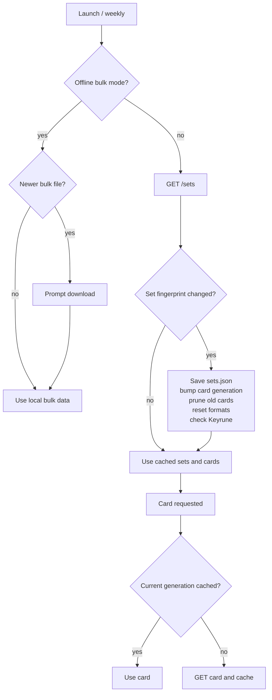

# Data freshness

One refresh policy: at launch and weekly, compare released sets with `sets.json`.
If the fingerprint changed, bump the card-cache generation and continue.

## Caches

| Data | Refresh |
|---|---|
| `sets.json` | Replaced when the set fingerprint changes; `getSets()` only reads it |
| Card metadata | Only the current generation is used; old generations are pruned on refresh |
| Card metadata edits | `Ctrl+R` refetches the selected card; **Clear cache** removes everything |
| Cached reprint list | Cleared with the card generation |
| Formats | Memory cache reset on refresh or **Clear cache** |
| Card images | Downloaded once per card ID; never refreshed automatically |
| Scryfall set icons | Downloaded on demand; failed downloads are not retried until restart or cache reset |
| Keyrune / Proxyglyph | Checked weekly via `resources_date`; new sets trigger a Keyrune check |
| Bulk file | Prompted at startup when the remote `updated_at` is newer |
| Bulk SQLite index | Rebuilt when the source file or schema changes |

## Gaps

- Card prices and legalities have no TTL.
- Card images have no automatic refresh.
- Bulk updates are prompted only at startup.
- Offline bulk mode skips the online set check.
- Scryfall set-icon failures have no fallback; Keyrune falls back to the set code in the table.
