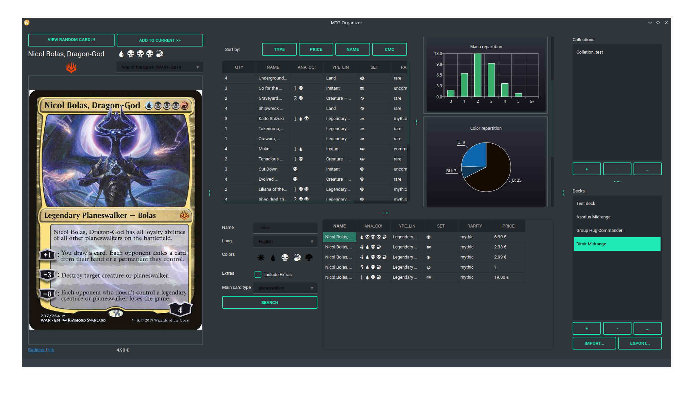

# MTG Organizer

## Why another card organizer

I've been using [Magic Assistant](https://sourceforge.net/projects/mtgbrowser/) for a bit, it's clunky, outdated, but mostly works. I'd like to help improve it, but I have no wish to learn a new code langage.
I've looked at other solutions, but found them to be either out of date, unmaintained, behind a paywall, or just missing important features.
Hence this "MTG Organizer" project (name will change for sure)

## Features & Current status

Still development but most features are already here

Here are the lists of things I'd like to have included in this project :

| Feature | Status |
| --- | --- |
| Search through MTG database | Done: Name (with typo fallback in bulk mode), Colors, Type(s), Set, Rarity, CMC, Oracle text, tagger tags, Format, Power/Toughness/Loyalty|
| Support for other languages than EN | Card handling done in all available MTG languages, GUI translations not handled (yet)|
|Organizing cards in decks & collections| Done. Missing drag/drop between collections/decks, missing sideboard/commander support |
|Add deck visualizations and tools| total card/prices/legality, mana curve, color/type graphs (Legality WIP)|
|Import| MTGA, CSV (Urza Gatherer, MTG Studio, MTGGoldfish, MTG Manager, Deckbox, Decked Builder, PucaTrade, TCGPlayer, Deckstats), MTGO (.dek), EDHRec URL |
|Export| Started : export to cardmarket decklist|
|Scan from webcam| Would be nice to have|
|Synchronization / Connection to other DBs|Local TinyDB for now, can be synchronized with a "drive" solution|
|Multiplatform Windows/Linux/Mac| Windows, Linux & Mac OK |
|Offline mode| Done: opt-in Scryfall bulk data (card data offline, images online)|

## Known issues

- In online-only mode, card data is cached locally as it is requested. There is no automatic full cache refresh; use **Settings > Scryfall > Clear cache** if cached data becomes stale. Offline bulk mode checks for bulk-data updates on startup.
- On some instances, card art may not be correct if scrolling through cards quickly. This is caused by a race condition when requesting multiple images on a poor connection to the web. I added a "Ctrl+R" shortcut to force reload currently selected card for now.
- Card searches run in the background, but some heavy operations (like importing a large collection) can still freeze the GUI while they load data.
- Missing half-mana symbols (un-sets)
- Missing 1,000,000 mana symbol (Gleemax)
- Partial phyrexian font handling
- Bug on sorting / removal
- Handling image with multiple pictures (e.g. Urza's mine) and alternate art
- Keyrune has no icon for some promo/art-series sets; those show the set code instead
- In bulk mode, art/oracle tag filters fall back to online Scryfall, and the Include Extras checkbox is disabled
- Missing button to clear all search terms
- Add tooltip to view card translations
- Show english name when browsing other languages

## Requirements

> Python 3.10+
> pip modules listed in requirements.txt

## Install / Usage

For now, this is not packaged in an executable file, so you have to run it from source code.

Clone this repo, then when in the folder, install dependencies

- windows (with system python or venv activated)
  - > py -m pip install -r requirements.txt
- linux/mac (with a venv already set)
  - >venv/bin/python -m pip install -r requirements.txt

For development and tests, use `requirements-dev.txt` instead.

then run the main program from the repository root

- windows
  - > py mtgorg/mtgorg_app.py
- linux/mac (venv)
  - >venv/bin/python mtgorg/mtgorg_app.py

Click the status bar message to open the full session log.

**Settings > Search** caps how many matching cards are shown (default 100). If
more cards match, a notice above the results tells you the list was truncated.

## Offline mode

Open **Settings > Scryfall...** to enable offline bulk data. Choose between
`default_cards` (English printings, smaller) and `all_cards` (all languages,
larger), then download the file. Card records, searches, reprints, set choices,
and legalities work offline; card images and missing non-English printings still
use Scryfall online, with rate limiting applied.

On first use, the bulk file is converted to a local SQLite index (about 10
seconds for `default_cards`, with a progress dialog). Later lookups are fast and
low-memory. The same dialog shows the downloaded file and data date, reports
disk usage for decks,
caches, bulk files, and the SQLite index, can check for updates, and has
**Clear cache** to remove cached cards, images, set icons, set metadata, and the
SQLite index without deleting the downloaded bulk file.

The card viewer's printing dropdown lists the available printings and variants
(set, collector number, showcase/promo/foil-only labels) so you can pick the
exact printing you want.

## F.A.Q.

- Where are my decks and collection saved ?
  - In `~/.mtgo/mtg_org.db`. It is a minimal local database that stores your decks and collections.

- Where is the cache stored ?
  - In `~/.mtgo/`:
    - `mtg_org_cache.db`: cached card records
    - `card_imgs/`: card images
    - `sets_icons/`: set icon SVGs
    - `infos/sets.json`: set metadata
    - `scryfall_bulk/`: downloaded bulk files and their SQLite indexes
  - Use **Settings > Scryfall > Clear cache** to clean everything except your decks, collections, and downloaded bulk files.

- Search/Import is slow
  - In online-only mode, data is fetched and cached as you request it, so large imports depend on your connection and Scryfall rate limits.
  - In offline bulk mode, the first search after downloading a bulk file builds the SQLite index; after that, lookups are local and fast.

## Credits

- [Scryfall](https://scryfall.com/)
- Andrew Gioia : [Keyrune](https://github.com/andrewgioia/keyrune) : expansion symbols (used under GPL 3.0 license)
- MrTeferi : [Proxyshop](https://github.com/MrTeferi/Proxyshop) : proxygliyph font mana symbols (Mozilla public license 2.0)
- NandaScott : [Scrython](https://github.com/NandaScott/Scrython) : Python wrapper for scryfall requests (MIT License)
- WotC, card creators, artists, and MTG community for everything MTG.

## Licence

I have absolutely no idea all of this works, I'm not a software engineer and do not have a law degree. From what I understand, this code should be GPL v3 compatible (since it uses parts which are MIT/GPL3/MPL2) but I would prefer to seek help from the community before choosing a licence.
